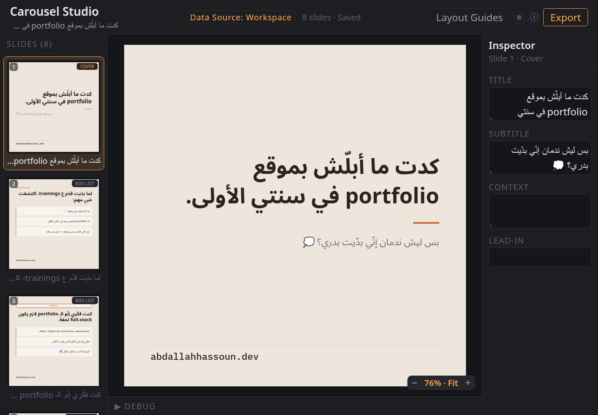
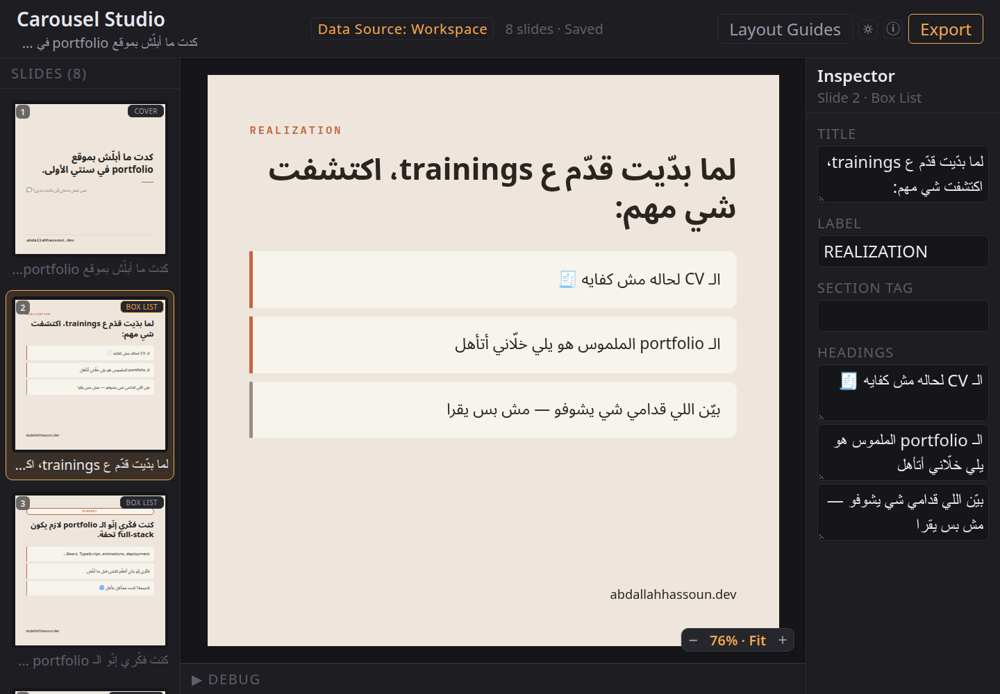
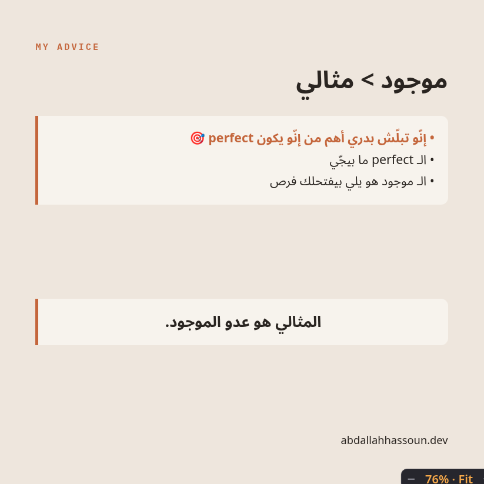
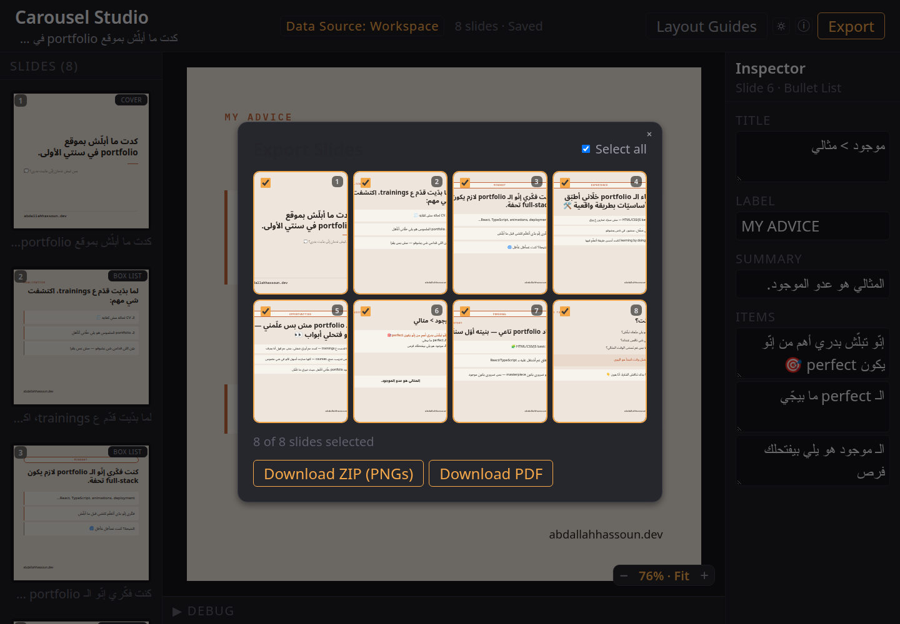

# Content OS

**AI-Assisted Content Automation System**

Content OS is a personal content-production system that turns real development work, project decisions, and ideas into structured content ready for publishing.

I built it to remove the repetitive parts of my content workflow: capturing ideas from coding work, evaluating whether they are worth developing, writing a canonical draft, adapting it for each platform, rendering carousels, validating layouts, exporting assets, and archiving the final published version.

The system combines repository-based AI agent workflows with a React and TypeScript Studio for reviewing, editing, rendering, and exporting carousel content.

> The current Studio is desktop-focused. Responsive UI is not implemented yet.

---

## Studio

The Studio is the working interface for reviewing and editing carousel content.

It loads structured carousel data from the workspace, renders each slide through reusable layouts, and exposes slide-specific fields through an inspector.

<p align="center">
  
</p>

The sidebar provides navigation across the carousel, the center canvas renders the selected slide, and the inspector exposes the structured fields supported by that layout.

---

## What Content OS Automates

The workflow covers the full path from a development experience to a published post:

```text
Coding / project work
        ↓
Automatic idea capture
        ↓
Idea quality gate
        ↓
Approved content brief
        ↓
Canonical draft
        ↓
Editorial review
        ↓
Platform adaptation
        ↓
Structured carousel JSON
        ↓
React renderer + Studio
        ↓
Visual validation
        ↓
PNG / PDF export
        ↓
Published archive
```

Project agents can capture useful content ideas from completed development work into `content/ideas/` according to the repository's idea-capture rules.

The content is not published automatically. Ideas still pass through explicit quality, writing, review, rendering, and approval stages before publication.

---

## Structured Slide Editing

Carousel slides are represented as structured data rather than arbitrary canvas elements.

Different layouts expose different fields through the Studio inspector, allowing content to change without manually editing the React components for every post.

<p align="center">
  
</p>

The renderer maps the workspace content model into typed presentation models and selects the appropriate React layout for each slide.

This separation keeps:

```text
Content
   ↓
Content Model
   ↓
Adapter
   ↓
Typed Renderer Model
   ↓
Layout Component
   ↓
Rendered Slide
```

instead of coupling post copy directly to the UI implementation.

---

## Renderer

The carousel renderer is built with React, TypeScript, and Vite.

It includes reusable slide layouts and rendering primitives for headings, body text, lists, badges, evidence blocks, footers, and other recurring visual structures.

<p align="center">
  
</p>

The active carousel lives in:

```text
production/workspace/carousel.json
```

The application loads that structured workspace data and maps it into renderer-specific models.

A bundled sample fixture is also available for development and fallback behavior.

---

## Export Workflow

The Studio can export selected carousel slides directly from the browser.

<p align="center">
  
</p>

Two export paths are supported.

### Studio Export

The client-side export flow uses:

- `html-to-image`
- `JSZip`
- `jsPDF`

Selected slides can be rendered off-screen at higher resolution and downloaded as:

```text
ZIP of PNG files
PDF
```

### Automated Playwright Export

A separate export pipeline uses Playwright against the frozen `/export` route.

```text
Workspace JSON
      ↓
/export
      ↓
Full-scale rendered slides
      ↓
Playwright
      ↓
PNG files
```

The automated path is useful when consistent browser-rendered output is required without manually exporting each slide.

---

## Layout Validation

The Studio includes optional layout guides for checking slide boundaries and safe areas during review.

<p align="center">
  
</p>

The guides are development tools only. They are disabled in thumbnails and final exports.

This makes it possible to validate layout constraints without changing the final rendering logic.

---

## AI-Assisted Workflow

Content OS uses repository instructions and specialized agent skills to divide content work into explicit responsibilities.

The current skills include:

| Skill                       | Responsibility                                                  |
| --------------------------- | --------------------------------------------------------------- |
| `content-strategist`        | Evaluates whether an idea is worth developing                   |
| `content-editor`            | Reviews reasoning, clarity, specificity, and factual boundaries |
| `lebanese-arabic-writing`   | Handles natural Lebanese Arabic phrasing                        |
| `arabic-technical-language` | Keeps Arabic and English technical terminology consistent       |
| `carousel-copy-polish`      | Reviews carousel structure, pacing, density, and slide flow     |
| `content-reviewer`          | Runs the final editorial gate                                   |
| `content-refinement`        | Coordinates an end-to-end refinement pass when requested        |

The workflow deliberately separates responsibilities instead of asking one generic agent to handle everything.

For example:

```text
Idea
  ↓
content-strategist
  ↓
Canonical meaning
  ↓
content-editor
  ↓
Language / voice
  ↓
Format-specific refinement
  ↓
content-reviewer
```

For Arabic technical carousels, language review can also involve:

```text
lebanese-arabic-writing
+
arabic-technical-language
+
carousel-copy-polish
```

These are repository-level agent workflows. Content OS does not currently embed an LLM API inside the React application.

---

## Content Lifecycle

Content moves through separate filesystem stages.

### Ideas

```text
content/ideas/
```

Each captured idea can contain:

```text
idea.json
supporting resources
```

Ideas can come from manual capture or from project agents following the automatic idea-capture rules.

### Drafts

```text
content/drafts/
```

The canonical draft is format-neutral.

Approved platform adaptations can then be generated under:

```text
content/drafts/format/
```

For example:

```text
carousel.md
linkedin.md
```

### Workspace

Carousel content is converted into structured renderer data at:

```text
production/workspace/carousel.json
```

### Published Archive

Published content is preserved by platform:

```text
content/published/
├── instagram/
└── linkedin/
```

Each archive keeps the exact content that was published rather than reconstructing it later from the current draft.

---

## Architecture

The repository is split between content intelligence, lifecycle data, production tooling, and engineering documentation.

```text
Content OS/
├── .agents/
│   └── skills/                 # Specialized AI-agent workflows
│
├── framework/
│   ├── strategy/               # Brand and audience rules
│   ├── formats/                # Platform and format definitions
│   ├── workflows/              # Content lifecycle and automation rules
│   ├── model/                  # Structured content contracts
│   └── memory/                 # Published-content index
│
├── content/
│   ├── ideas/                  # Captured development/content ideas
│   ├── drafts/                 # Canonical and adapted drafts
│   └── published/              # Exact published variants
│
├── production/
│   ├── renderer/               # React + TypeScript Studio and renderer
│   ├── workspace/              # Active structured carousel
│   └── export/                 # Playwright export pipeline
│
├── docs/
│   ├── architecture/
│   ├── design/
│   ├── development/
│   └── product/
│
└── README.md
```

---

## Renderer Architecture

Inside the React application, responsibilities are separated further:

```text
production/renderer/src/
├── renderer/
│   ├── adapter/
│   ├── components/
│   ├── data/
│   ├── layouts/
│   ├── models/
│   └── safety/
│
├── studio/
│
└── export-view/
```

### `renderer/`

Owns loading, mapping, presentation models, reusable layouts, rendering primitives, and safety guides.

### `studio/`

Owns the interactive authoring and review interface:

- slide navigation
- live preview
- inspector
- layout guides
- export modal
- development/debug tooling

### `export-view/`

Provides a stable rendering surface for the automated Playwright export pipeline.

---

## Tech Stack

### Application

- React
- TypeScript
- Vite
- React Router

### Rendering & Export

- html-to-image
- JSZip
- jsPDF
- Playwright

### Content & Automation

- structured JSON content models
- repository-based agent skills
- automatic development-idea capture
- staged editorial workflows
- platform-specific content adaptation

### Engineering

- typed renderer models
- reusable layout components
- data-to-renderer adapters
- deterministic export route
- Node.js tests
- architecture and implementation documentation

---

## Local Development

The Studio lives under:

```text
production/renderer/
```

Install dependencies:

```bash
cd production/renderer
npm install
```

Start the development server:

```bash
npm run dev
```

Build the application:

```bash
npm run build
```

Run renderer tests:

```bash
npm test
```

The Vite development server reads the active carousel from:

```text
production/workspace/carousel.json
```

---

## Documentation

The README is intentionally an overview. Detailed implementation decisions live under `docs/`.

### Architecture

- [`docs/architecture/00-System Architecture.md`](docs/architecture/00-System%20Architecture.md)
- [`docs/architecture/01-Renderer Architecture.md`](docs/architecture/01-Renderer%20Architecture.md)
- [`docs/architecture/02-Studio Architecture.md`](docs/architecture/02-Studio%20Architecture.md)

### Development

- [`docs/development/00-Layout Development Guide.md`](docs/development/00-Layout%20Development%20Guide.md)
- [`docs/development/01-Self-Service Carousel MVP Plan.md`](docs/development/01-Self-Service%20Carousel%20MVP%20Plan.md)
- [`docs/development/02-Template-System-and-Content-Fit-Plan.md`](docs/development/02-Template-System-and-Content-Fit-Plan.md)

The repository also contains separate product and design documentation under:

```text
docs/product/
docs/design/
```

---

## Current Status

Content OS currently includes:

- automatic idea capture from development work
- structured content lifecycle
- specialized AI-agent workflows
- canonical and platform-specific content stages
- React/TypeScript Carousel Studio
- reusable typed layouts
- live slide editing and preview
- layout safety guides
- client-side PNG/PDF export
- Playwright-based automated export
- published-content archive
- architecture, product, design, and development documentation

The current Studio targets desktop use. Responsive Studio support and the broader self-service creation flow remain future work.
